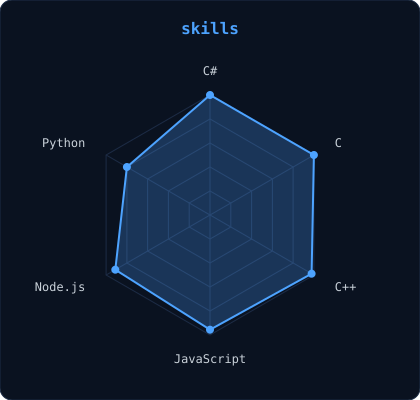
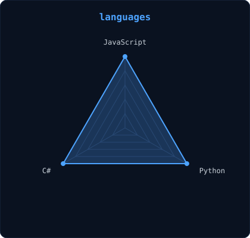
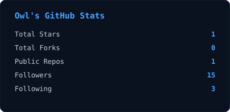

---

## 🦉 about me

I'm **Mussa**, a backend developer. I build websites and the backend systems behind them.

- 💼 **Work:** freelance websites and backend development
- ⚙️ **Languages:** C, C# and C++ (strongest), plus JavaScript and Python
- 🎯 **Approach:** clean, maintainable code
- 🧰 **Daily tools:** GitHub and VS Code

## 🧰 tech I use

---

## 📡 skills and languages

|  |  |
| --- | --- |

---

## 📊 my stats

`Owl · backend developer`

